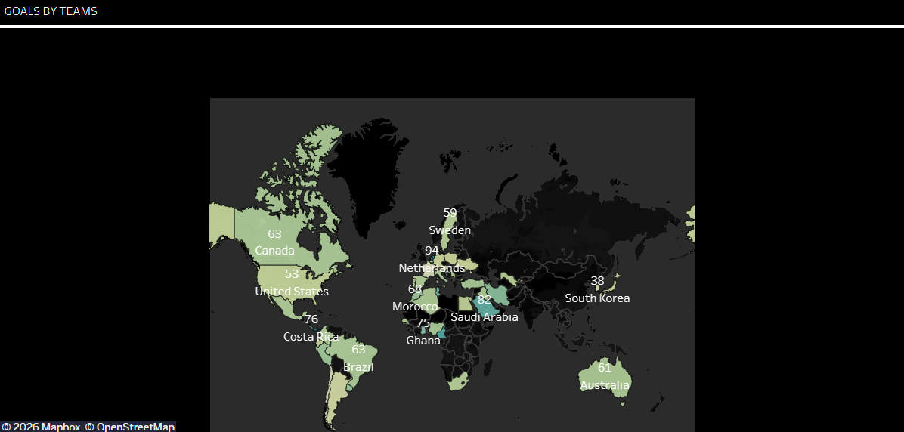
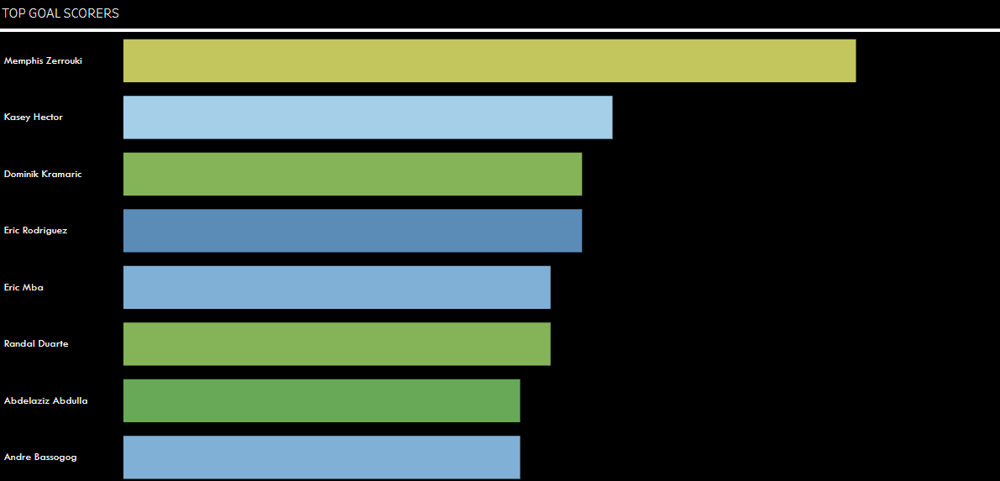
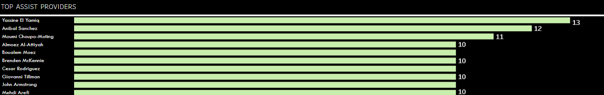
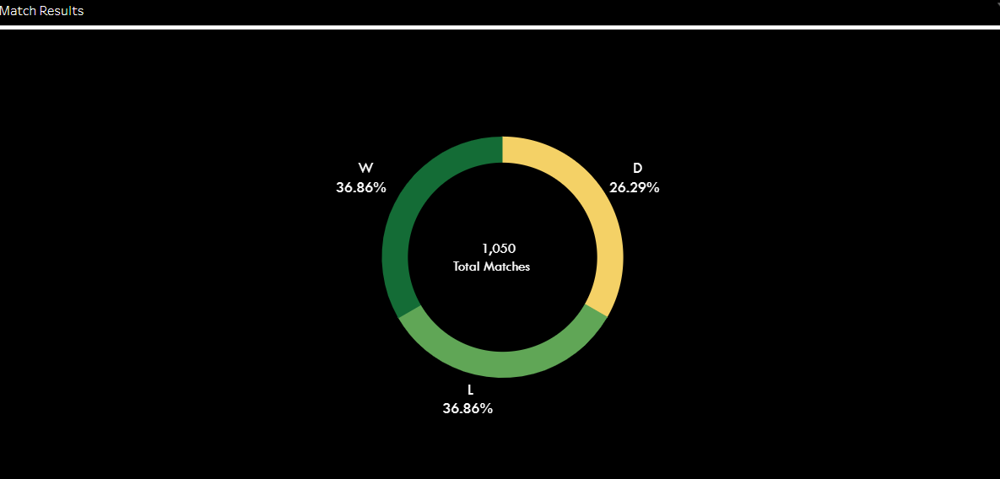
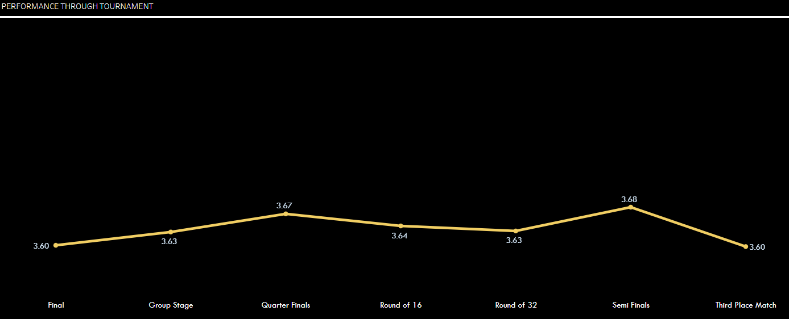
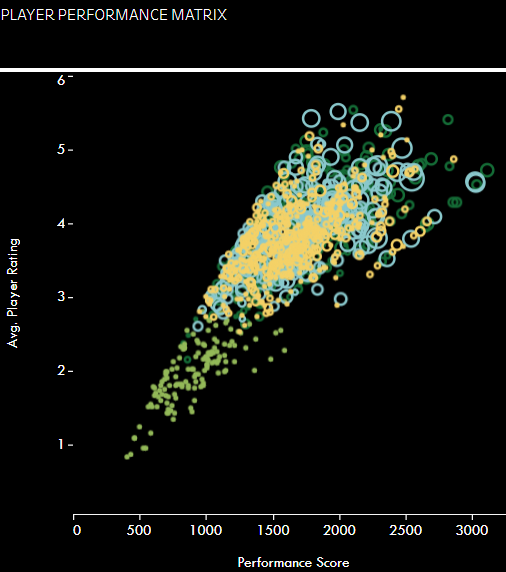
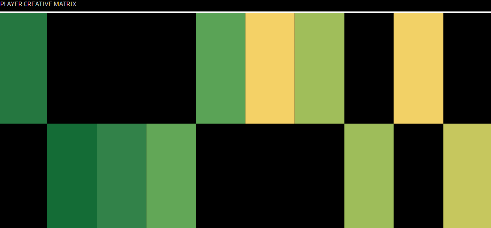
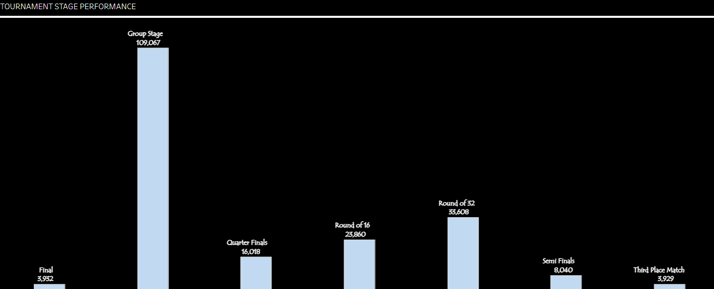
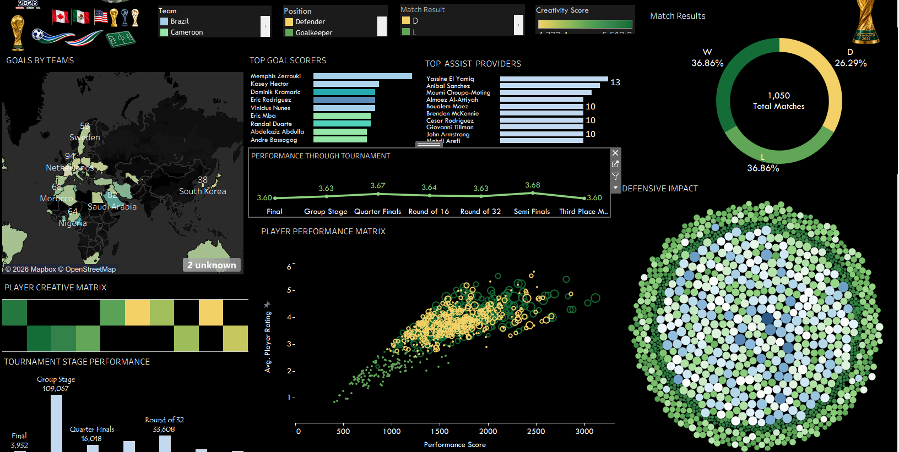

# ⚽FIFA World Cup 2026 – Data Analytics & Visualization

## Dashboard Link

**Tableau Public Dashboard:** [https://public.tableau.com/app/profile/kritika.khanduri/viz/FIFAWORLDCUP2026FINALDASHBOARD/Dashboard1]
## Project Overview

The **FIFA World Cup 2026 Analytics Dashboard** is an interactive data visualization project designed to explore tournament performance, team statistics, player contributions, and match outcomes.

The project transforms football data into meaningful visual insights using Tableau, combining multiple visualization techniques to analyze different dimensions of tournament performance.

From identifying top goal scorers and assist providers to exploring player creativity, defensive impact, and team performance across tournament stages, this dashboard provides a comprehensive view of football analytics.

## Project Objectives

    - Analyze team performance and geographical distribution across countries.
    - Identify top goal scorers and assist providers.
    - Explore match results, including wins, losses, and draws.
    - Evaluate player performance through creativity and defensive indicators.
    - Compare tournament performance across different stages.
    - Discover relationships between player ratings and overall performance.
    - Present complex football statistics through interactive visual storytelling.

## Dashboard Highlights

    The dashboard includes the following visualizations:

### 1. Goals by Teams – Geographical Analysis
    A geographical visualization highlighting team-level goal statistics across different countries, helping explore the distribution of football performance.

### 2. Top Goal Scorers
    A comparative ranking of players based on their goal contributions throughout the tournament.

### 3. Top Assist Providers
    Highlights players contributing to team success through assists and creative playmaking.

### 4. Match Results Distribution
A doughnut chart illustrating the distribution of match outcomes:

    - Wins
    - Losses
    - Draws

### 5. Performance Through Tournament
    A trend analysis comparing performance scores across tournament stages, from the group stage to the knockout rounds and final

### 6. Player Performance Matrix
    A scatter plot examining the relationship between player performance scores and average player ratings, helping identify performance patterns and standout players.
    

### 7. Player Creative Matrix
    A visual matrix representing player creativity-related performance indicators.

### 8. Defensive Impact
    A bubble-based visualization highlighting defensive performance indicators and player contributions.

### 9. Tournament Stage Performance
    A comparative visualization exploring performance distribution across different stages of the competition.

##  Interactive Dashboard Features
    The dashboard includes interactive filters to enable customized analysis:

- **Team:** Explore statistics for selected teams.
- **Position:** Filter players by their playing positions.
- **Match Result:** Analyze wins, losses, and draws.
- **Creativity Score:** Explore players based on creativity-related performance.

These filters allow users to interact with the dashboard and examine different aspects of tournament performance.

## Tools & Technologies

- **Tableau:** Dashboard development and data visualization.
- **Microsoft Excel:** Data preparation and organization.
- **Data Analytics:** Comparative analysis and performance evaluation.
- **Data Visualization:** Geographical mapping, scatter plots, doughnut charts, bar charts, and matrix-based visualizations.

## Key Analytical Areas

This project focuses on exploring several important dimensions of football analytics:

    - Team-level performance comparison.
    - Individual player contributions.
    - Goal-scoring and playmaking analysis.
    - Match outcome distribution.
    - Player creativity and defensive performance.
    - Performance trends across tournament stages.

## Dashboard Preview

![FIFA World Cup 2026 Dashboard](images/# ⚽FIFA World Cup 2026 – Data Analytics & Visualization

## Dashboard Link

**Tableau Public Dashboard:** [https://public.tableau.com/app/profile/kritika.khanduri/viz/FIFAWORLDCUP2026FINALDASHBOARD/Dashboard1]
## Project Overview

The **FIFA World Cup 2026 Analytics Dashboard** is an interactive data visualization project designed to explore tournament performance, team statistics, player contributions, and match outcomes.

The project transforms football data into meaningful visual insights using Tableau, combining multiple visualization techniques to analyze different dimensions of tournament performance.

From identifying top goal scorers and assist providers to exploring player creativity, defensive impact, and team performance across tournament stages, this dashboard provides a comprehensive view of football analytics.

## Project Objectives

    - Analyze team performance and geographical distribution across countries.
    - Identify top goal scorers and assist providers.
    - Explore match results, including wins, losses, and draws.
    - Evaluate player performance through creativity and defensive indicators.
    - Compare tournament performance across different stages.
    - Discover relationships between player ratings and overall performance.
    - Present complex football statistics through interactive visual storytelling.

## Dashboard Highlights

    The dashboard includes the following visualizations:

### 1. Goals by Teams – Geographical Analysis
    A geographical visualization highlighting team-level goal statistics across different countries, helping explore the distribution of football performance.

### 2. Top Goal Scorers
    A comparative ranking of players based on their goal contributions throughout the tournament.

### 3. Top Assist Providers
    Highlights players contributing to team success through assists and creative playmaking.

### 4. Match Results Distribution
A doughnut chart illustrating the distribution of match outcomes:

    - Wins
    - Losses
    - Draws

### 5. Performance Through Tournament
    A trend analysis comparing performance scores across tournament stages, from the group stage to the knockout rounds and final

### 6. Player Performance Matrix
    A scatter plot examining the relationship between player performance scores and average player ratings, helping identify performance patterns and standout players.
    

### 7. Player Creative Matrix
    A visual matrix representing player creativity-related performance indicators.
    

### 8. Defensive Impact
    A bubble-based visualization highlighting defensive performance indicators and player contributions.

### 9. Tournament Stage Performance
A comparative visualization exploring performance distribution across different stages of the competition.

##  Interactive Dashboard Features

The dashboard includes interactive filters to enable customized analysis:

- **Team:** Explore statistics for selected teams.
- **Position:** Filter players by their playing positions.
- **Match Result:** Analyze wins, losses, and draws.
- **Creativity Score:** Explore players based on creativity-related performance.

These filters allow users to interact with the dashboard and examine different aspects of tournament performance.

## Tools & Technologies

- **Tableau:** Dashboard development and data visualization.
- **Microsoft Excel:** Data preparation and organization.
- **Data Analytics:** Comparative analysis and performance evaluation.
- **Data Visualization:** Geographical mapping, scatter plots, doughnut charts, bar charts, and matrix-based visualizations.

## Key Analytical Areas

This project focuses on exploring several important dimensions of football analytics:

    - Team-level performance comparison.
    - Individual player contributions.
    - Goal-scoring and playmaking analysis.
    - Match outcome distribution.
    - Player creativity and defensive performance.
    - Performance trends across tournament stages.

## Dashboard Preview

## Project Purpose

This project demonstrates the application of data analytics and visualization techniques in sports analytics. It reflects my interest in transforming raw datasets into structured insights and developing interactive dashboards that make data easier to explore, interpret, and communicate.

**Turning football data into meaningful insights, one visualization at a time!** 

---

